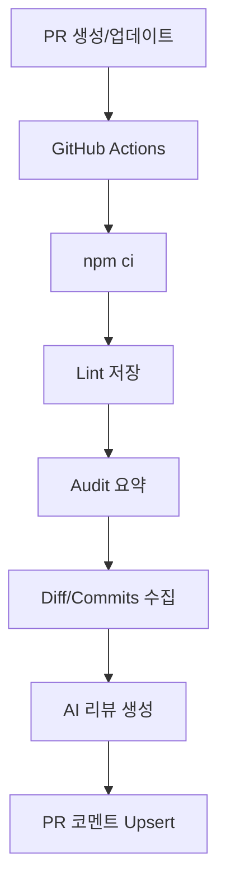

---


## Prologue


PR 리뷰를 하다 보면, 중요한 체크포인트가 매번 동일한데도 빠지는 경우가 생기기 마련…


이번에는 AI를 "요약 도구"가 아니라, PR 단계에서 반복 검증을 자동 수행하는 "리뷰 파이프라인"으로 붙여 보았다


이 글은 아래 항목들을 PR마다 자동 점검하도록 구성한 과정과 구현 코드를 기록해보았음.


매번 모두 챙기기 어렵고 귀찮기 때문에 PR 이벤트마다 AI가 1차 리뷰를 자동으로 남기고 최종 판단은 사람이 하는 구조를 작성하기로 함


---


## 대상 선정


코드 리뷰 시 주로 다음 항목의 검증이 필요

- 커밋 메시지 템플릿 적합성 확인
- 레이어/네이밍 등 코딩 컨벤션 위반 여부 확인
- 보안 취약점 체크
- 성능 영향 포인트 점검

---


## 목표와 설계 원칙


### 목표


PR 생성/갱신 시 자동으로:

- 코드/커밋/정적 검사 결과를 수집
- AI 리뷰 생성
- PR 댓글 upsert

### 설계 원칙

- 모델에게 규칙 문서를 직접 주입해 일관성을 확보
- lint/audit 실패가 있어도 리뷰 파이프라인은 계속 진행
- 동일 PR에서 코멘트를 계속 누적하지 않고 기존 코멘트를 갱신

---


## 전체 Pipeline 구조





핵심 파일:


| 파일                                   | 역할                                             |
| ------------------------------------ | ---------------------------------------------- |
| .github/workflows/ai-code-review.yml | PR 시 lint/audit/AI 리뷰를 실행하는 CI workflow        |
| .github/scripts/ai-pr-review.mjs     | PR diff/커밋/산출물을 수집하고 AI Agent 호출하여 코멘트를 upsert |
| .gitmessage.txt                      | 커밋 메시지 형식/금지 패턴 기준 정의                          |
| .github/ai-review/review-rules.md    | 리뷰 항목, 심각도 순서, 출력 포맷 기준 정의                     |
| CONVENSIONS.md                       | 프로젝트 레이어/네이밍 컨벤션 기준 문서                         |


---


## GitHub Actions 워크플로우


"CI 통과/실패" 보다 "리뷰에 필요한 근거 데이터 수집"이 주요 목적


핵심 단계만 요약하면 다음과 같음:

1. PR 이벤트에서 워크플로우 시작 (`opened`, `synchronize`, `reopened`)
2. `npm ci`로 실행 환경 고정
3. `lint` 결과를 파일로 저장 (`.github/artifacts/lint.txt`)
4. `npm audit` 결과를 요약 파일로 변환 (`audit-summary.txt`)
5. AI 리뷰 스크립트 실행 후 PR 코멘트 업서트

**핵심 포인트:**

- `fetch-depth: 0`: base/head 기준 diff와 커밋 로그를 정확히 수집하기 위함
- `lint/audit` non-blocking: 실패해도 리뷰 파이프라인은 계속 진행 (`|| true`)
- Secret guard: `ANTHROPIC_API_KEY` 가 없으면 실패 대신 경고 후 스킵

**주요 코드:** 


```yaml
# .github/workflows/ai-code-review.yml

#...
on:
  pull_request:
    types: [opened, synchronize, reopened]

steps:
  - uses: actions/checkout@v4
    with:
      fetch-depth: 0

  - uses: actions/setup-node@v4
    with:
      node-version: 20
      cache: npm

  - run: npm ci
  - run: npm run lint > .github/artifacts/lint.txt 2>&1 || true
  - run: npm audit --omit=dev --json > .github/artifacts/audit.json 2>&1 || true
  - run: node .github/scripts/ai-pr-review.mjs
    env:
      GITHUB_TOKEN: ${{ secrets.GITHUB_TOKEN }}
      ANTHROPIC_API_KEY: ${{ secrets.ANTHROPIC_API_KEY }}
      
#...
```


---


## AI 리뷰 스크립트


리뷰의 핵심은 `.github/scripts/ai-pr-review.mjs`  파일


### 데이터 수집

- PR 범위 파일 목록
- PR 범위 커밋 메시지
- unified diff
- 규칙 문서(`CONVENSIONS.md`, 커밋 템플릿, 리뷰 규칙)
- lint 결과
- audit 요약

### 모델 호출


Anthropic Messages API(`/v1/messages`)에 system/user 입력을 전달해 한국어 리뷰를 생성


### 댓글 Upsert


`<!-- ai-pr-review -->` 마커를 사용해 중복 댓글이 계속 쌓이는 문제를 방지

- 이전 댓글이 있으면 PATCH
- 없으면 POST

**핵심 코드 :**


```javascript
/* .github/scripts/ai-pr-review.mjs */

//...

const MARKER = '<!-- ai-pr-review -->'

const changedFiles = run(`git diff --name-only ${baseSha}...${headSha}`)
const commits = run(`git log --reverse --pretty=format:"%h%x09%s" ${baseSha}..${headSha}`)
const diff = run(`git diff --unified=3 ${baseSha}...${headSha}`)

const prompt = `...\\n[Project Conventions]\\n${conventions}\\n[Commits]\\n${commits}\\n[Diff]\\n${diff}`

const claudeResponse = await fetch('https://api.anthropic.com/v1/messages', {
  method: 'POST',
  headers: {
    'x-api-key': anthropicApiKey,
    'anthropic-version': '2023-06-01',
    'Content-Type': 'application/json',
  },
  body: JSON.stringify({
    model,
    max_tokens: 4096,
    system:
      'You are a senior software reviewer. You provide concrete, actionable, evidence-based code review comments in Korean.',
    messages: [
      {
        role: 'user',
        content: prompt,
      },
    ],
  }),
})

//...
```


---


## 규칙 문서 전략


아래 규칙을 prompt에 포함해서 결과 편차를 최소화 하도록 개선


### 커밋 메시지 규칙


`.gitmessage.txt` 파일로 정의

- `<type>(<scope>): <subject>`
- 허용 type 제한
- 72자 제한
- 금지 패턴(`update`, `wip` 등)

### 리뷰 출력 규칙


`.github/ai-review/review-rules.md` 파일로 정의

- 4개 점검 항목 강제
- 심각도 순서 강제
- "문제/영향/개선 제안" 포맷 강제
- 불확실하면 "추정" 표기

---


## 실제 운영 팁


### 토큰/프롬프트 길이 관리


diff가 큰 PR에서는 토큰이 급격히 늘어나기 때문에 `truncate()`로 섹션별 최대 길이를 제한하기.


### 보안 자동화는 "신호"로 사용


`npm audit`는 런타임 영향이 적은 경고도 많기 때문에, 바로 차단보다 리뷰 코멘트의 근거 데이터로 쓰는 방식이 실용적.


### 최종 판단은 사람


AI 리뷰는 1차 필터로 두고, 도메인 정책/비즈니스 의사결정은 사람이 최종 승인하는 게 안전합니다.


---


## 개선점

- PR 요약 댓글 -> 파일/라인 단위 인라인 리뷰로 확장
- 인증/권한/결제/DB write 경로는 별도 가중치 적용
- Critical 이슈 탐지 시 required check 실패 처리
- 리뷰 히스토리 축적으로 프로젝트 맞춤 프롬프트 진화

---


## Epilogue


이번 자동화의 핵심은 "모델 선택"보다 "리뷰 기준을 구조화한 입력"이었습니다.

- 규칙 문서
- 정적 분석 결과
- 커밋 로그
- 실제 diff

이 4가지를 함께 제공하면, 개인 프로젝트에서도 재현 가능한 품질의 AI 리뷰 파이프라인을 운영할 수 있다.

